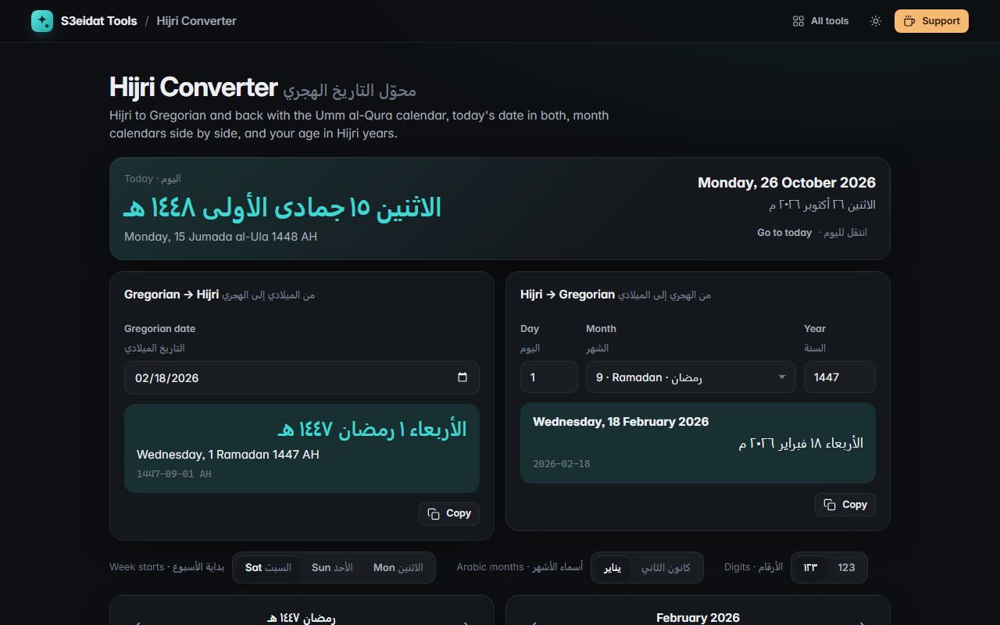

# Hijri Converter · محوّل التاريخ الهجري

> Hijri to Gregorian dates and back, with the Umm al-Qura calendar. Free, private, and it runs entirely in your browser.

### ▶ [Open Hijri Converter](https://s3eidat.github.io/hijri-converter/)



## Features

- **Gregorian → Hijri** and **Hijri → Gregorian**, kept in sync: change either side and the other follows
- **Today** in both calendars, in Arabic and English, with the day of the week
- **Month calendars side by side**: the Hijri month (in Arabic, right to left) and the Gregorian month, each showing the other calendar's day; click any day to convert it
- Arabic and English month names, with a choice of يناير or كانون الثاني style for Gregorian months, and ١٢٣ or 123 digits
- Week starting on Saturday, Sunday or Monday
- **Age in Hijri years** (years, months, days), Gregorian age, days lived and the date of your next Hijri birthday
- Tells you when a Hijri month has only 29 days

## How it works

The converter uses the Umm al-Qura calendar built into your browser (`Intl.DateTimeFormat` with `islamic-umalqura`).
Hijri → Gregorian searches for the Gregorian day whose Umm al-Qura date matches exactly, so both directions always agree.
Supported range: 1300–1600 AH (1882–2174 CE).

**Official dates can differ.** Ramadan, Eid and Hajj are announced after moon sighting, which can be a day off the
calculated calendar and can differ between countries.

## Privacy

Nothing leaves your device. There is no server, no account, no analytics.
The page ships with a strict Content-Security-Policy (`connect-src 'self'`), so the browser
itself blocks any attempt to send data anywhere.

## Run it yourself

It's plain HTML, CSS and JavaScript with no build step:

```bash
git clone https://github.com/s3eidat/hijri-converter
cd hijri-converter
python -m http.server 8000
```

Then open http://localhost:8000.

## Support

If this saved you time, **[buy me a coffee ☕](https://s3eidat.github.io/coffee/)**. It keeps every tool free.

---

Part of **[S3eidat Tools](https://s3eidat.github.io/)**: 100+ free, private tools that run in your browser. MIT licensed.
